# crr-taller-git-2026

Repositorio del **Taller de Git y Modelado Orientado a Objetos** — Asignatura: **Lenguajes de Programación 3 (CYT646)** — Año 2026.  
Alumno: **César Ramírez Román** (`cesarraa`).  
Dominio seleccionado: **Counter-Strike 2 (CS2)**.  
Licencia: **Apache License 2.0** (ver archivo [LICENSE](LICENSE)).

---

## Enlace al Commit de la Solución

- **Commit de la entrega:** https://github.com/cesarraa/crr-taller-git-2026/commit/62066c81e70ff5432d503aabdc4122af595ff1e7

---

## 1. Organización de Paquetes

Siguiendo estrictamente las especificaciones del template de la cátedra ([lp3-template-tp](https://github.com/alefq/lp3-template-tp/tree/main/src/main/java/py/edu/uc/lp3)):

```text
src/main/java/py/edu/uc/lp3/
├── Cs2Application.java                     # Arranque de Spring Boot (@SpringBootApplication)
├── domain/                                 # Clases de dominio del modelo de CS2
│   ├── Arma.java                           # Clase base abstracta (Familia Arma)
│   ├── Francotirador.java                  # Especialización de Arma e implementa UICapable (reemplaza default)
│   ├── Pistola.java                        # Especialización de Arma
│   ├── Escopeta.java                       # Especialización de Arma
│   ├── Subfusil.java                       # Especialización de Arma
│   ├── Granada.java                        # Especialización de Arma
│   ├── GranadaFlash.java                   # Especialización de Granada
│   ├── GranadaHumo.java                    # Especialización de Granada
│   ├── GranadaIncendiaria.java             # Especialización de Granada
│   ├── GranadaTipo.java                    # Enum de tipos de granada
│   ├── Jugador.java                        # Familia independiente e implementa UICapable (usa default)
│   └── UICapable.java                      # Interface del dominio con mensaje de texto y default method
└── rest/controller/                        # Capa de presentación REST (Servicios HTTP)
    ├── IndexController.java                # GET /
    ├── ArmaController.java                 # GET /armas/construir, /armas/comportamientos, /armas/disparar
    └── UIController.java                   # GET /ui/elementos, /ui/renderizar (consumo vía interfaz)
```

---

## 2. Diagrama de Clases (Mermaid)

El siguiente diagrama refleja fielmente la jerarquía de herencia, visibilidad de miembros, constructores y métodos implementados en `src/main/java/py/edu/uc/lp3/domain/`:

```mermaid
classDiagram
    class Arma {
        <<abstract>>
        #String nombre
        #float precio
        #int dano
        #float peso
        #int municionMax
        #int municionActual
        +Arma(nombre, precio, dano)
        +Arma(nombre, precio, dano, peso, municionMax)
        +describirComportamiento()* String
        +disparar() String
        +disparar(distanciaMetros) String
        +disparar(distanciaMetros, tiroALaCabeza) String
        +recargar() String
        +obtenerPrecio() int
        +obtenerNombre() String
    }

    class Pistola {
        -String modoDisparo
        -int cargador
        +Pistola()
        +Pistola(nombre, precio, dano)
        +Pistola(nombre, precio, dano, peso, municionMax, modoDisparo, cargador)
        +describirComportamiento() String
    }

    class Francotirador {
        -int zoom
        +Francotirador()
        +Francotirador(nombre, precio, dano, zoom)
        +Francotirador(nombre, precio, dano, peso, municionMax, zoom)
        +describirComportamiento() String
        +activarZoom() String
    }

    class Escopeta {
        -int cartuchos
        -float dispersion
        +Escopeta()
        +Escopeta(nombre, precio, dano, cartuchos)
        +Escopeta(nombre, precio, dano, peso, municionMax, cartuchos, dispersion)
        +describirComportamiento() String
    }

    class Subfusil {
        -String modoDisparo
        -int cargador
        +Subfusil()
        +Subfusil(nombre, precio, dano, cargador)
        +Subfusil(nombre, precio, dano, peso, municionMax, modoDisparo, cargador)
        +describirComportamiento() String
    }

    class Granada {
        #GranadaTipo tipoGranada
        #float radioExplosion
        +Granada(nombre, precio, dano, tipoGranada)
        +Granada(nombre, precio, dano, peso, municionMax, tipoGranada, radioExplosion)
        +lanzar() String
        +describirComportamiento() String
    }

    class GranadaFlash {
        +GranadaFlash()
        +GranadaFlash(nombre, precio, dano, peso, municionMax, radioExplosion)
    }

    class GranadaHumo {
        +GranadaHumo()
        +GranadaHumo(nombre, precio, dano, peso, municionMax, radioExplosion)
    }

    class GranadaIncendiaria {
        +GranadaIncendiaria()
        +GranadaIncendiaria(nombre, precio, dano, peso, municionMax, radioExplosion)
    }

    class GranadaTipo {
        <<enumeration>>
        HUMO
        FLASH
        INCENDIARIA
    }

    class UICapable {
        <<interface>>
        +renderizarUI() String$
        +getImagen() String$
        +getPosicion() String$
        +getSonido() String$
        +getVelocidad() String$
    }

    class Jugador {
        -String alias
        -String bando
        -int salud
        -int dinero
        +Jugador()
        +Jugador(alias, bando, salud, dinero)
        +getImagen() String
        +getPosicion() String
        +recibirDanio(cantidad) void
        +estaVivo() boolean
    }

    Arma <|-- Pistola
    Arma <|-- Francotirador
    Arma <|-- Escopeta
    Arma <|-- Subfusil
    Arma <|-- Granada
    Granada <|-- GranadaFlash
    Granada <|-- GranadaHumo
    Granada <|-- GranadaIncendiaria
    Granada --> GranadaTipo
    UICapable <|.. Francotirador : implementa (reemplaza default)
    UICapable <|.. Jugador : implementa (usa default)
```



---

## 3. Sobrecarga vs. Sobreescritura

En este ejercicio se aplicaron los dos mecanismos fundamentales del polimorfismo en la Programación Orientada a Objetos:

### ¿Qué cambió con la Sobrecarga (Overloading)?

La **sobrecarga** ocurre cuando existen múltiples métodos (o constructores) con el **mismo nombre pero diferente lista de parámetros** dentro de la misma clase o jerarquía. Se resuelve en **tiempo de compilación** (*polimorfismo estático*):

1. **Constructores sobrecargados:**
   - En la clase base `Arma`: se incorporó un constructor simple `Arma(nombre, precio, dano)` con valores estándar seguros (2.5 kg, 20 balas), junto al constructor completo sobrecargado `Arma(nombre, precio, dano, peso, municionMax)`.
   - En `Francotirador`: constructor por defecto `Francotirador()`, constructor simple `Francotirador(nombre, precio, dano, zoom)` y constructor sobrecargado completo `Francotirador(nombre, precio, dano, peso, municionMax, zoom)`.
   - En `Pistola`: constructor por defecto `Pistola()`, constructor simple `Pistola(nombre, precio, dano)` y constructor completo `Pistola(nombre, precio, dano, peso, municionMax, modoDisparo, cargador)`.
   - Cada constructor garantiza la invariante de estado: ningún constructor permite dejar el objeto en un estado inconsistente o con campos ilegales. Las subclases delegan la inicialización de atributos base mediante llamadas obligatorias a `super(...)`.
2. **Sobrecarga de mensajes del dominio (`disparar`):**
   - `disparar()`: Disparo simple a quemarropa sin argumentos adicionales.
   - `disparar(int distanciaMetros)`: Disparo especificando distancia, aplicando atenuación balística en el cálculo del daño efectivo.
   - `disparar(int distanciaMetros, boolean tiroALaCabeza)`: Disparo de alta precisión con cálculo de multiplicador crítico por *headshot*.

### ¿Qué cambió con la Sobreescritura (Overriding)?

La **sobreescritura** ocurre cuando una clase hija redefine un método de la clase padre manteniendo **exactamente la misma firma** (mismo nombre, mismos parámetros y tipo de retorno compatible). Se resuelve en **tiempo de ejecución** (*polimorfismo dinámico o enlace tardío*):

1. **Método abstracto en la clase base:**
   - La clase `Arma` declara: `public abstract String describirComportamiento();`
   - La clase padre no puede ni debe saber cómo opera cada familia de arma; esa responsabilidad pertenece a las clases concretas.
2. **Sobreescritura en clases hijas independientes:**
   - `Pistola` sobreescribe `@Override public String describirComportamiento()` informando su función como arma secundaria de combate cerrado, cadencia rápida y capacidad de su cargador.
   - `Francotirador` sobreescribe `@Override public String describirComportamiento()` detallando su rol quirúrgico a larga distancia con magnificación de mira óptica xZoom y penalización de dispersión sin apuntar.
3. **Consumo polimórfico en el Controller:**
   - En `ArmaController.listarComportamientos()` se almacena una colección `List<Arma>` que contiene tanto instancias de `Pistola` como de `Francotirador`.
   - El controlador interactúa con todas las instancias exclusivamente a través del tipo base `Arma` e invoca `arma.describirComportamiento()` sin requerir condicionales (`if/else`) ni inspección de tipos (`instanceof`).

### Comparación Conceptual

| Criterio | Sobrecarga (Overloading) | Sobreescritura (Overriding) |
|---|---|---|
| **Definición** | Mismo nombre de método con distinta firma (parámetros) | Misma firma exacta redefinida en una subclase |
| **Ubicación** | En la misma clase o heredada | En una clase hija (relación de herencia) |
| **Momento de resolución** | Tiempo de compilación (*enlace temprano*) | Tiempo de ejecución (*enlace tardío / dynamic dispatch*) |
| **Palabra clave / Anotación** | Ninguna obligatoria | `@Override` |
| **Ejemplo en el proyecto** | `disparar()` vs `disparar(distancia)` / Constructores | `describirComportamiento()` en `Francotirador` y `Pistola` |

---

---

## 4. Interfaces y Métodos por Defecto (`default` methods)

En cumplimiento de la consigna de la cátedra para el taller de interfaces:
> *"Elegí una capacidad que compartan dos clases de tu modelo, y que esas dos clases estén en familias distintas.*  
> *Declarala como interface en domain, con un mensaje que devuelva texto.*  
> *Cada clase la implementa a su modo. Una de las dos puede reemplazar un default.*  
> *Un servicio REST pide ese mensaje a través del tipo de la interfaz y responde JSON.*  
> *Minecraft o Counter-Strike 2, el que ya venís modelando. El ejemplo de la pizarra es para mirar la forma:*  
> *`UICapable { imagen; posicion; sonido; velocidad; }`"*

### 4.1. Declaración de la Interfaz en `domain`
Se definió la interface `py.edu.uc.lp3.domain.UICapable` que modela la capacidad de cualquier elemento del juego para renderizarse en la interfaz de usuario (HUD, radar, inventario) de CS2:
- **Mensaje que devuelve texto:** `String renderizarUI()`
- **Implementación por defecto (`default` method):** La interface provee una implementación base de `renderizarUI()` que concatena los atributos gráficos y de audio (`getImagen()`, `getPosicion()`, `getSonido()`, `getVelocidad()`).

### 4.2. Dos Clases en Familias Distintas
1. **Familia Arma (`Francotirador`):**
   - Pertenece a la jerarquía de herencia de `Arma` (`Francotirador extends Arma implements UICapable`).
   - **Reemplaza el default (`@Override`):** Redefine completamente `renderizarUI()` para mostrar el visor táctico de mira óptica (`awp_scope.png`), nivel de magnificación (`x2`), slot inferior derecho del HUD y estado en tiempo real de munición.
2. **Familia Jugador (`Jugador`):**
   - Pertenece a una jerarquía independiente (`Jugador implements UICapable`), completamente desacoplada de `Arma`.
   - **Aprovecha el default:** No sobreescribe `renderizarUI()`, consumiendo directamente la implementación por defecto provista por la interfaz `UICapable`, personalizando únicamente el icono de radar (`assets/ui/radar/dot_ct.png`) y su posición en pantalla.

### 4.3. Consumo REST a través del Tipo de la Interfaz
En `UIController` (`py.edu.uc.lp3.rest.controller.UIController`), los elementos se manipulan exclusivamente mediante referencias del tipo `UICapable`:
```java
List<UICapable> elementos = List.of(
    new Jugador("s1mple", "Antiterrorista", 100, 16000),
    new Francotirador("AWP", 4750f, 115, 4.3f, 10, 2)
);

for (UICapable elemento : elementos) {
    // Se pide el mensaje polimórfico a través del tipo de la interfaz:
    String textoUI = elemento.renderizarUI();
}
```

---

## 5. Ocultamiento de la Información e Invariantes

> **Pregunta de anclaje de la rúbrica:** *¿Qué ocurre si el controller asigna a mano la vida o la munición? ¿Puede otra clase dejar el objeto en un estado imposible?*

- **Respuesta:** No, es imposible. Los atributos de las clases son `protected` y `private`.
- No existen setters públicos que permitan alterar libremente `municionActual` o la `salud` de un jugador.
- La munición solo puede alterarse a través de los mensajes del dominio: `disparar()` y `recargar()`.
- La salud de `Jugador` solo se reduce a través de `recibirDanio(cantidad)`, impidiendo valores negativos o superiores a 100.
- Todos los constructores y setters validan invariantes lanzando `IllegalArgumentException` ante parámetros inconsistentes.

---

## 6. Instrucciones de Ejecución y Pruebas

### Arrancar el Microservicio

```bash
./mvnw spring-boot:run
```

El servicio iniciará en el puerto local `8080`.

### Probar los Servicios REST

#### 1. Confirmar estado del servicio (`GET /`)
```bash
curl -s http://localhost:8080/ | jq .
```

#### 2. Listar Elementos UI polimórficamente (`GET /ui/elementos`)
Demuestra el consumo polimórfico de clases en familias distintas (`Jugador` y `Francotirador`) tratadas como `UICapable`, evidenciando el uso y reemplazo del `default`:
```bash
curl -s http://localhost:8080/ui/elementos | jq .
```
Respuesta JSON:
```json
[
  {
    "clase": "Jugador",
    "familia": "Familia Jugador (Personaje/Entidad)",
    "tipoInterfaz": "py.edu.uc.lp3.domain.UICapable",
    "reemplazaMetodoDefault": false,
    "mensajeUI": "Renderizado HUD genérico CS2 [imagen='assets/ui/radar/dot_ct.png', posicion='HUD_RADAR_TOP_LEFT (x: 50, y: 50)', sonido='sounds/ui/hud_beep.wav', velocidad='1.0x (60 FPS)']",
    "imagen": "assets/ui/radar/dot_ct.png",
    "posicion": "HUD_RADAR_TOP_LEFT (x: 50, y: 50)",
    "sonido": "sounds/ui/hud_beep.wav",
    "velocidad": "1.0x (60 FPS)"
  },
  {
    "clase": "Francotirador",
    "familia": "Familia Arma (Balística)",
    "tipoInterfaz": "py.edu.uc.lp3.domain.UICapable",
    "reemplazaMetodoDefault": true,
    "mensajeUI": "HUD Francotirador [AWP] -> Imagen: 'assets/ui/weapons/awp_scope.png' | Posición: 'HUD_BOTTOM_RIGHT (x: 1820, y: 980)' | Sonido: 'sounds/weapons/sniper_zoom.wav' | Velocidad: '0.85x (animación lenta de mira)' | Zoom óptico: x2 | Munición en pantalla: 10/10",
    "imagen": "assets/ui/weapons/awp_scope.png",
    "posicion": "HUD_BOTTOM_RIGHT (x: 1820, y: 980)",
    "sonido": "sounds/weapons/sniper_zoom.wav",
    "velocidad": "0.85x (animación lenta de mira)"
  }
]
```

#### 3. Renderizar Elemento Individual vía Interfaz (`GET /ui/renderizar`)
- Francotirador (reemplaza default):
  ```bash
  curl -s "http://localhost:8080/ui/renderizar?tipo=francotirador&nombre=AWP+Asiimov" | jq .
  ```
- Jugador (utiliza default):
  ```bash
  curl -s "http://localhost:8080/ui/renderizar?tipo=jugador&nombre=coldzera&bando=Terrorista" | jq .
  ```

#### 4. Endpoints de Armas
- Construcción simple: `curl -s "http://localhost:8080/armas/construir?tipo=francotirador&nombre=AWP&precio=4750&dano=115&zoom=2" | jq .`
- Comportamientos polimórficos: `curl -s http://localhost:8080/armas/comportamientos | jq .`
- Sobrecarga de disparo: `curl -s "http://localhost:8080/armas/disparar?distancia=60&headshot=true" | jq .`

### Ejecutar Pruebas Automatizadas
```bash
./mvnw test
```
