# crr-taller-git-2026

Repositorio del **Taller de Git, Modelado Orientado a Objetos y Persistencia en H2** — Asignatura: **Lenguajes de Programación 3 (CYT646)** — Año 2026.  
Alumno: **César Ramírez Román** (`cesarraa`).  
Dominio seleccionado: **Counter-Strike 2 (CS2)**.  
Licencia: **Apache License 2.0** (ver archivo [LICENSE](LICENSE)).

---

## Enlace al Commit de la Solución (POO-08 y su corrección)

- **Commit de la corrección POO-08:** se indica en el último commit de este historial (actualización de este enlace).
- **Commit original de la entrega POO-08:** https://github.com/cesarraa/crr-taller-git-2026/commit/3e361a4c9d3f3d5ebb1ba7ad69a7e85854c2d0d7
- **Commit previo POO-07 (Interfaces):** https://github.com/cesarraa/crr-taller-git-2026/commit/4d0095d
- **Commit previo POO-06 (Herencia/Paquetes):** https://github.com/cesarraa/crr-taller-git-2026/commit/62066c81e70ff5432d503aabdc4122af595ff1e7

---

## Cierre de las observaciones de la corrección POO-08

| Observación de la corrección | Cómo quedó cerrada |
|---|---|
| `JugadorController` usaba `JugadorRepository` directamente | Se creó `JugadorService`; el controller solo traduce HTTP y el repositorio se usa solo desde services. |
| El dominio lanzaba excepciones y contenía reglas de negocio | `Arma`, `Jugador` y sus hijas quedaron como estado y accessors. Validaciones, daño, munición y excepciones están en `ArmaService`, `JugadorService` y `SimulacionService`. |
| Atributos `protected` y constructor vacío `public` | Todos los campos son `private`; el constructor requerido por JPA es `protected`. La entrada JSON usa DTOs (`ArmaRequest`, `JugadorRequest`). |
| Precio negativo respondía distinto en POST y PATCH | Un única regla en `ArmaService`: todo precio fuera de `0..16000` lanza `EconomiaInvalidaException` (422) en POST, PUT y PATCH. |
| `Arma` dejó de ser abstracta | Volvió a ser `abstract`; AK-47 y M4A4 son ahora `Fusil`, una hija concreta. |
| `GET /ui/elementos` armaba las instancias en el método | Ahora lee el `Jugador` y el `Francotirador` persistidos a través de los services; un test comprueba que refleja la munición guardada. |
| `Granada()` llamaba al padre con daño 0 | El constructor vacío usa daño 50, un estado legal. |
| El constructor simple de `Francotirador` repetía la lógica del zoom | Delega con `this(...)` en el constructor completo. |
| El 409 de munición agotada exigía 31 disparos | El pedido `10b` deja el cargador en 0 y el pedido `11` provoca el 409 en un solo disparo. |
| La clave `tipo` aparecía dos veces en el JSON | `getTipo()` lleva `@JsonIgnore`; el único `tipo` es el discriminador de Jackson. |
| Faltaban respuestas de "Qué hay que pensar" | Se agregaron recurso/verbo, identidad, justificación de `SINGLE_TABLE` y el valor de depender de la interfaz del repositorio. |
| El recorrido de Insomnia saltaba del pedido 13 al 15 | El recorrido nombra ahora los 17 pedidos, incluido el `14 - GET /ui/renderizar` y el nuevo `10b`. |

---

## 1. Cómo Arrancar la Aplicación

El proyecto utiliza **Maven Wrapper** y **Spring Boot 4.1.1** (compilado para Java 21+):

```bash
./mvnw spring-boot:run
```

Una vez iniciado, el servicio queda disponible en:
- **API REST:** `http://localhost:8080/`
- **Consola Web H2:** `http://localhost:8080/h2-console`
  - **JDBC URL:** `jdbc:h2:mem:cs2db`
  - **User Name:** `sa`
  - **Password:** *(vacía)*

---

## 2. Propiedades de H2 y JPA Explicadas (`application.properties`)

- `spring.application.name=cs2`: identificador lógico de la aplicación.
- `spring.datasource.url=jdbc:h2:mem:cs2db`: base H2 en memoria, aislada bajo el nombre `cs2db`.
- `spring.datasource.driverClassName=org.h2.Driver`: driver JDBC de H2.
- `spring.datasource.username=sa`: usuario administrador de la conexión.
- `spring.datasource.password=`: contraseña vacía, para desarrollo y pruebas.
- `spring.jpa.database-platform=org.hibernate.dialect.H2Dialect`: dialecto SQL de H2 para Hibernate.
- `spring.jpa.hibernate.ddl-auto=update`: Hibernate crea/actualiza las tablas al arrancar según las entidades `@Entity`.
- `spring.jpa.show-sql=true`: muestra las sentencias SQL ejecutadas para depuración.
- `spring.jpa.properties.hibernate.format_sql=true`: formatea esas sentencias en consola.
- `spring.h2.console.enabled=true`: habilita la consola web de H2.
- `spring.h2.console.path=/h2-console`: ruta de acceso a la consola.

---

## 3. Organización de Paquetes (Arquitectura en 3 Capas)

```text
src/main/java/py/edu/uc/lp3/
├── Cs2Application.java                     # Arranque de Spring Boot (@SpringBootApplication)
├── config/
│   └── DataInitializer.java               # Carga inicial de armas y jugadores en H2
├── domain/                                 # Entidades: solo estado, sin reglas ni excepciones
│   ├── Arma.java                           # Entidad base abstracta (@Entity, SINGLE_TABLE, Jackson)
│   ├── Fusil.java                          # Hija concreta; AK-47 y M4A4
│   ├── Francotirador.java                  # Hija de Arma e implementa UICapable
│   ├── Pistola.java                        # Hija de Arma
│   ├── Escopeta.java                       # Hija de Arma
│   ├── Subfusil.java                       # Hija de Arma
│   ├── Granada.java                        # Hija de Arma
│   ├── GranadaFlash.java                   # Hija de Granada
│   ├── GranadaHumo.java                    # Hija de Granada
│   ├── GranadaIncendiaria.java             # Hija de Granada
│   ├── GranadaTipo.java                    # Enum de tipos de granada
│   ├── Jugador.java                        # Entidad independiente e implementa UICapable
│   └── UICapable.java                      # Interfaz de dominio con default method (POO-07)
├── exception/                              # Jerarquía de excepciones lanzadas por los services
│   ├── DominioCS2Exception.java            # Base unchecked
│   ├── MunicionAgotadaException.java       # Hija 1 -> 409 Conflict
│   ├── EconomiaInvalidaException.java      # Hija 2 -> 422 Unprocessable Entity
│   ├── RecursoNoEncontradoException.java   # 404 Not Found
│   └── ReglaNegocioException.java          # 400 Bad Request
├── repository/                             # Interfaces Spring Data JPA
│   ├── ArmaRepository.java                 # JpaRepository<Arma, Long> con consultas derivadas
│   └── JugadorRepository.java              # JpaRepository<Jugador, Long>
├── service/                                # Validaciones, reglas del juego y transacciones
│   ├── ArmaService.java                    # CRUD, balística, munición y construcción de subtipos
│   ├── JugadorService.java                 # CRUD y validación de combatientes
│   ├── SimulacionService.java              # Orquesta la simulación persistida de las 2 reglas
│   └── ResultadoSimulacion.java            # DTO del resultado de la simulación
└── rest/
    ├── controller/
    │   ├── IndexController.java            # GET /
    │   ├── ArmaCrudController.java         # CRUD REST en /api/armas
    │   ├── ArmaController.java             # Endpoints históricos de demostración POO-06/07
    │   ├── JugadorController.java          # Endpoints en /api/jugadores
    │   ├── SimulacionController.java       # /api/simulacion/combate y /estado
    │   ├── UIController.java               # /ui/elementos y /ui/renderizar
    │   └── GlobalExceptionHandler.java     # Handler dedicado por tipo de excepción
    └── dto/
        ├── ArmaRequest.java                # Entrada JSON del arma (sin lógica)
        └── JugadorRequest.java             # Entrada JSON del jugador (sin lógica)
```

---

## 4. Diagrama de Clases Mermaid

```mermaid
classDiagram
    class UICapable {
        <<interface>>
        +getImagen()* String
        +getPosicion()* String
        +getSonido() String
        +getVelocidad() String
        +renderizarUI() String
    }

    class Arma {
        <<abstract>>
        -Long id
        -String nombre
        -float precio
        -int dano
        -float peso
        -int municionMax
        -int municionActual
        #Arma()
        +describirComportamiento()* String
        +getTipo() String
    }

    class Fusil {
        +describirComportamiento() String
    }
    class Francotirador {
        -int zoom
        +describirComportamiento() String
        +renderizarUI() String
    }
    class Pistola {
        -String modoDisparo
        -int cargador
        +describirComportamiento() String
    }
    class Jugador {
        -Long id
        -String alias
        -String bando
        -int salud
        -int dinero
        +getImagen() String
        +getPosicion() String
    }

    Arma <|-- Fusil : Herencia
    Arma <|-- Francotirador : Herencia
    Arma <|-- Pistola : Herencia
    UICapable <|.. Francotirador : Reemplaza default
    UICapable <|.. Jugador : Usa default

    class ArmaRepository {
        <<interface>>
        +existsByNombreIgnoreCase(nombre) boolean
        +existsByNombreIgnoreCaseAndIdNot(nombre, id) boolean
    }
    class JugadorRepository {
        <<interface>>
    }

    class ArmaService {
        -ArmaRepository armaRepository
        +crear(ArmaRequest) Arma
        +actualizar(id, ArmaRequest) Arma
        +actualizarParcial(id, campos) Arma
        +dispararArma(id, distancia, headshot) String
        +recargarArma(id) Arma
        +calcularDanioEfectivo(arma, distancia, headshot) int
        +consumirMunicion(arma) void
    }
    class JugadorService {
        -JugadorRepository jugadorRepository
        +crear(JugadorRequest) Jugador
        +buscarPorId(id) Jugador
        +validarDatos(JugadorRequest) void
    }
    class SimulacionService {
        +ejecutarSimulacionCombate(sniperId, pistolaId, jugadorId, dist, headshot) ResultadoSimulacion
        +obtenerEstadoSimulacion() Map
    }

    ArmaService --> ArmaRepository : Usa interfaz
    JugadorService --> JugadorRepository : Usa interfaz
    SimulacionService --> ArmaService : Regla 1
    SimulacionService --> JugadorService : Regla 2

    class ArmaCrudController
    class JugadorController
    class UIController
    class SimulacionController
    ArmaCrudController --> ArmaService
    JugadorController --> JugadorService
    UIController --> ArmaService
    UIController --> JugadorService
    SimulacionController --> SimulacionService

    class RuntimeException {
        <<Java Base>>
    }
    class DominioCS2Exception {
        <<Base Dominio>>
    }
    class MunicionAgotadaException {
        <<Hija 1>>
    }
    class EconomiaInvalidaException {
        <<Hija 2>>
    }
    class ReglaNegocioException
    class RecursoNoEncontradoException

    RuntimeException <|-- DominioCS2Exception
    DominioCS2Exception <|-- MunicionAgotadaException
    DominioCS2Exception <|-- EconomiaInvalidaException
    DominioCS2Exception <|-- ReglaNegocioException
    DominioCS2Exception <|-- RecursoNoEncontradoException

    class GlobalExceptionHandler {
        +409 MunicionAgotadaException
        +422 EconomiaInvalidaException
        +400 ReglaNegocioException
        +404 RecursoNoEncontradoException
    }
    GlobalExceptionHandler ..> MunicionAgotadaException : Handler por tipo
    GlobalExceptionHandler ..> EconomiaInvalidaException : Handler por tipo
```



---

## 5. Las Dos Reglas de Negocio en una Frase Cada Una

1. **Regla 1 (Balística y consumo de munición — `ArmaService` sobre `Fusil`, `Francotirador` y `Pistola`):** al disparar se calcula el daño efectivo según distancia y subtipo, se descuenta una bala del cargador y, si no queda munición, `ArmaService` lanza `MunicionAgotadaException`.
2. **Regla 2 (Impacto y salud vital — `SimulacionService` sobre `Jugador`):** el daño de ambos disparos se acumula y `SimulacionService` fija la salud del jugador en `max(0, salud - danio)`, dejando a cero al combatiente eliminado.

`SimulacionService.ejecutarSimulacionCombate` dispara ambas reglas sobre tres objetos y guarda los tres estados en H2.

---

## 6. Respuestas a "Qué hay que pensar"

### 1. Recurso y verbo
El sustantivo de la API es **el arma**: la colección es `/api/armas`. `POST` crea en la colección; `GET /api/armas` lista y `GET /api/armas/{id}` lee un ítem; `PUT` y `PATCH` actualizan; `DELETE` quita el ítem. La simulación es otro recurso, `/api/simulacion/combate`, creado con `POST` y consultado con `GET /api/simulacion/estado`. El verbo HTTP dice la operación; la URL nombra el recurso.

### 2. Identidad
La clave es `id` (`Long`) de cada entidad, generada por JPA con `@GeneratedValue(strategy = GenerationType.IDENTITY)`. El JSON de creación la omite: `ArmaRequest` y `JugadorRequest` no tienen campo `id`, así que el cliente no puede elegir la clave ni colisionar con una fila existente.

### 3. Herencia y tablas
Elegimos `InheritanceType.SINGLE_TABLE` con la columna discriminadora `tipo_arma`. En **nuestro** dominio las armas comparten casi todos sus atributos (nombre, precio, daño, peso y munición) y las diferencias son pocos campos propios de cada hija (`zoom`, `cargador`, `cartuchos`, etc.). Una sola tabla evita joins para listar armas de distintos subtipos, que es justamente lo que hacen el CRUD y la simulación. Jackson distingue el subtipo con `tipo` en el JSON; `getTipo()` lleva `@JsonIgnore` para no duplicar esa clave.

### 4. Interfaz y repositorio
`ArmaRepository` y `JugadorRepository` son interfaces: Spring Data genera la implementación y los services las inyectan. Eso permite cambiar la persistencia sin tocar la lógica y probar los services sin SQL. Es la misma idea del protocolo de POO-07: `UICapable` es un contrato entre quien pide el mensaje y quien lo responde; el repositorio es un contrato entre quien pide datos y quien los entrega. El controller ya no habla con repositorios: solo con services.

### 5. Protocolo del dominio
`UICapable` (en `domain`) es la interfaz, con `renderizarUI()` como mensaje de texto y un `default method`. `GET /ui/elementos` y `GET /ui/renderizar` usan referencias `UICapable` sobre un `Francotirador` (familia `Arma`) y un `Jugador` (familia independiente), ambos leídos de H2. Sí puede hablar con instancias de familias distintas.

### 6. Ocultamiento e invariantes
Los atributos de las entidades son `private`, los constructores que pide JPA son `protected` y las entradas JSON son DTOs sin lógica. Ninguna entidad valida ni lanza excepciones: las reglas numéricas las sostiene `ArmaService` (precio `0..16000`, daño `1..500`, peso y munición positivos, unicidad de nombre) y `JugadorService` (salud `0..100`, dinero `0..16000`). El pedido `09` envía `dano: -15`, recibe `400` con `CS2_REGLA_NEGOCIO` y un `GET` posterior comprueba que la colección no creció.

### 7. PUT y PATCH
`PUT /api/armas/{id}` es reemplazo completo: exige nombre, precio, daño, peso y capacidad de munición; si falta uno, `ArmaService` rechaza la petición. `PATCH /api/armas/{id}` recibe un mapa con un subconjunto de claves y conserva las demás; por ejemplo `{"precio": 2650, "dano": 38}` no toca nombre, peso ni munición. Un PATCH con `{"municionActual": 0}` es válido y deja el arma con el cargador vacío.

### 8. DELETE
Borrar significa eliminar físicamente la fila de la tabla `armas` en H2. `ArmaService.eliminar` busca el arma con `buscarPorId` (404 si no existe) y llama a `armaRepository.delete`. La respuesta es `200` con un JSON de confirmación; un `GET` posterior por el mismo id responde `404`.

### 9. Dos reglas y simulación persistida
El disparo combinado de un `Francotirador` y una `Pistola` cambia el estado de tres objetos: cada arma gasta una bala y el `Jugador` recibe el daño total. El recurso es `POST /api/simulacion/combate` y el estado se consulta con `GET /api/simulacion/estado`; además, `GET /api/armas/{id}` y `GET /api/jugadores/{id}` muestran la munición y la salud ya persistidas.

### 10. Excepciones
`DominioCS2Exception` es la base no comprobada. `MunicionAgotadaException` nombra la regla del cargador vacío (409, `CS2_ARMA_SIN_MUNICION`) y `EconomiaInvalidaException` nombra el tope económico (422, `CS2_ECONOMIA_EXCEDIDA`). `RecursoNoEncontradoException` (404) y `ReglaNegocioException` (400) son tipos distintos de los anteriores. El JSON de error lleva `timestamp`, `status`, `error`, `tipoExcepcion`, `codigo`, datos de contexto y `mensaje`.

### 11. Preguntas de anclaje
- **Si cambiamos H2 por otra base:** se tocan `pom.xml` (driver) y `application.properties` (URL, credenciales y dialecto). Quedan quietos dominio, services, controllers, excepciones y repositorios: estos últimos son interfaces Spring Data.
- **¿Quién lanza la excepción?** La capa `service`, que es donde viven las validaciones y las reglas; el controller solo delega y `@RestControllerAdvice` convierte cada tipo en JSON y código HTTP.
- **¿Constructor vacío frente al ocultamiento?** JPA necesita un constructor sin argumentos; es `protected` en todas las entidades, así que solo lo usa el framework. Las entradas JSON llegan a DTOs y los services construyen las entidades con constructores de negocio.
- **Checked vs unchecked:** las excepciones de la jerarquía heredan de `RuntimeException` para no acoplar todas las firmas con `throws` y para que `@Transactional` haga rollback automático.
- **¿Cómo discrimina Jackson el subtipo?** El cliente envía `{"tipo": "FRANCOTIRADOR", ...}` en `ArmaRequest`; `ArmaService` construye la subclase correspondiente. Al serializar, `@JsonTypeInfo` agrega un único `tipo` y `@JsonIgnore` evita la clave duplicada de `getTipo()`.

---

## 7. Colección de Insomnia: Cómo Importar y Recorrer

La colección está versionada en `insomnia/insomnia_collection_lp3_poo08.json` y en `docs/insomnia/insomnia_collection_lp3_poo08.json`.

1. Abrir Insomnia y usar **Import Data → From File**.
2. Elegir uno de esos archivos.
3. Se crea el workspace **"LP3 - POO-08 CRUD H2 CS2 API"** con `base_url = http://localhost:8080`.

Orden de ejecución (17 pedidos):

1. **01 - GET /**: comprueba que el servicio está vivo.
2. **02 - POST /api/armas**: crea el `Francotirador` "SSG 08 Scout" (201).
3. **03 - POST /api/armas**: crea la `Pistola` "USP-S Táctica" (201).
4. **04 - GET /api/armas**: lista lo persistido con su `tipo`.
5. **05 - GET /api/armas/1**: busca el arma precargada.
6. **06 - PUT /api/armas/1**: reemplazo completo ("AK-47 Vulcan").
7. **07 - PATCH /api/armas/1**: cambia solo precio y daño.
8. **08 - DELETE /api/armas/2**: borra el arma 2; el `GET` posterior da 404.
9. **09 - POST Ilegal**: `dano: -15` → 400 `CS2_REGLA_NEGOCIO`; la base no crece.
10. **10 - GET ID Inexistente**: `/api/armas/999` → 404 `CS2_NOT_FOUND`.
11. **10b - PATCH /api/armas/1**: deja `municionActual: 0` en un paso.
12. **11 - Excepción Hija 1**: un único `POST /api/armas/1/disparar` → 409 `CS2_ARMA_SIN_MUNICION`.
13. **12 - Excepción Hija 2**: precio `25000` → 422 `CS2_ECONOMIA_EXCEDIDA`.
14. **13 - GET /ui/elementos**: consume `UICapable` con un jugador y un arma leídos de H2.
15. **14 - GET /ui/renderizar**: renderizado individual por la interfaz; muestra el estado persistido.
16. **15 - POST /api/simulacion/combate**: ejecuta las dos reglas y persiste munición y salud.
17. **16 - GET /api/simulacion/estado**: verifica el resultado en H2.

---

## 8. Ejecución de Pruebas Automatizadas

```bash
./mvnw clean test
```

Los 21 tests cubren constructores y sobreescritura, campos privados y constructor JPA protegido, CRUD, validaciones en services, ambos handlers de excepción, la simulación persistida y el endpoint de la interfaz leyendo estado real de H2.
