# crr-taller-git-2026

Repositorio del **Taller de Git, Modelado Orientado a Objetos y Persistencia en H2** — Asignatura: **Lenguajes de Programación 3 (CYT646)** — Año 2026.  
Alumno: **César Ramírez Román** (`cesarraa`).  
Dominio seleccionado: **Counter-Strike 2 (CS2)**.  
Licencia: **Apache License 2.0** (ver archivo [LICENSE](LICENSE)).

---

## Enlace al Commit de la Solución (POO-08)

- **Commit de la entrega POO-08:** https://github.com/cesarraa/crr-taller-git-2026/commit/{HASH_COMMIT_AQUI}
- **Commit previo POO-07 (Interfaces):** https://github.com/cesarraa/crr-taller-git-2026/commit/4d0095d
- **Commit previo POO-06 (Herencia/Paquetes):** https://github.com/cesarraa/crr-taller-git-2026/commit/62066c81e70ff5432d503aabdc4122af595ff1e7

---

## 1. Cómo Arrancar la Aplicación

El proyecto utiliza **Maven Wrapper** y **Spring Boot 4.1.1** (compilado para Java 21+):

```bash
# En Windows / Linux / macOS:
./mvnw spring-boot:run
```

Una vez iniciado, el servicio queda disponible en:
- **API REST:** `http://localhost:8080/`
- **Consola Web H2:** `http://localhost:8080/h2-console`
  - **JDBC URL:** `jdbc:h2:mem:cs2db`
  - **User Name:** `sa`
  - **Password:** *(vacía)*

---

## 2. Propiedades de H2 y JPA Explicadas (`application.properties`)

Cada línea del archivo `src/main/resources/application.properties` cumple una función específica en el ciclo de persistencia:

- `spring.application.name=cs2`: Define el identificador lógico de la aplicación en el ecosistema Spring.
- `spring.datasource.url=jdbc:h2:mem:cs2db`: Configura la base de datos relacional H2 en modo memoria (`mem`), aislada bajo el nombre `cs2db`.
- `spring.datasource.driverClassName=org.h2.Driver`: Especifica el driver JDBC oficial para comunicarse con el motor H2.
- `spring.datasource.username=sa`: Establece el usuario administrador del sistema (*System Administrator*) para la conexión.
- `spring.datasource.password=`: Deja la contraseña vacía, facilitando el acceso rápido en el entorno de desarrollo y pruebas.
- `spring.jpa.database-platform=org.hibernate.dialect.H2Dialect`: Instruye a Hibernate a utilizar el dialecto SQL específico de H2 para optimizar las sentencias generadas.
- `spring.jpa.hibernate.ddl-auto=update`: Hibernate crea automáticamente las tablas al arrancar según las entidades `@Entity` y actualiza el esquema sin destruir los datos durante la sesión.
- `spring.jpa.show-sql=true`: Muestra en la consola de comandos cada consulta SQL ejecutada (SELECT, INSERT, UPDATE, DELETE) para depuración.
- `spring.jpa.properties.hibernate.format_sql=true`: Aplica formato estructurado e identado a las consultas SQL impresas en consola para facilitar su lectura.
- `spring.h2.console.enabled=true`: Habilita la interfaz web interactiva de administración de H2.
- `spring.h2.console.path=/h2-console`: Determina la ruta web mediante la cual se accede a la consola gráfica desde el navegador.

---

## 3. Organización de Paquetes (Arquitectura en 3 Capas)

Siguiendo el estándar de paquetes del template de la cátedra ([lp3-template-tp](https://github.com/alefq/lp3-template-tp)):

```text
src/main/java/py/edu/uc/lp3/
├── Cs2Application.java                     # Arranque de Spring Boot (@SpringBootApplication)
├── config/                                 # Configuración y Carga Inicial
│   └── DataInitializer.java               # Pre-carga de datos canónicos CS2 en H2 (@Configuration)
├── domain/                                 # Capa de Dominio y Entidades JPA
│   ├── Arma.java                           # Entidad base persistente (@Entity, SINGLE_TABLE, Jackson polimórfico)
│   ├── Francotirador.java                  # Especialización de Arma e implementa UICapable (@Entity, Hija 1)
│   ├── Pistola.java                        # Especialización de Arma (@Entity, Hija 2)
│   ├── Escopeta.java                       # Especialización de Arma (@Entity)
│   ├── Subfusil.java                       # Especialización de Arma (@Entity)
│   ├── Granada.java                        # Especialización de Arma (@Entity)
│   ├── Jugador.java                        # Entidad independiente e implementa UICapable (@Entity)
│   └── UICapable.java                      # Interfaz de dominio con método default (POO-07)
├── exception/                              # Jerarquía de Excepciones del Dominio
│   ├── DominioCS2Exception.java            # Clase base de la jerarquía (Unchecked / RuntimeException)
│   ├── MunicionAgotadaException.java       # Excepción Hija 1 (Estado de arma sin balas -> 409 Conflict)
│   ├── EconomiaInvalidaException.java      # Excepción Hija 2 (Violación de tope de $16,000 -> 422 Unprocessable)
│   ├── RecursoNoEncontradoException.java   # Mapeada a HTTP 404 Not Found
│   └── ReglaNegocioException.java          # Mapeada a HTTP 400 Bad Request
├── repository/                             # Capa de Persistencia (Spring Data JPA)
│   ├── ArmaRepository.java                 # JpaRepository<Arma, Long> con consultas derivadas
│   └── JugadorRepository.java              # JpaRepository<Jugador, Long> para combatientes
├── service/                                # Capa de Lógica de Negocio y Simulación (Service)
│   ├── ArmaService.java                    # Reglas de validación, transaccionalidad y CRUD (@Service)
│   ├── SimulacionService.java              # Orquesta simulación balística con las 2 reglas (@Service)
│   └── ResultadoSimulacion.java            # DTO que transporta los resultados observables y persistidos
└── rest/controller/                        # Capa de Presentación REST (Controladores HTTP)
    ├── IndexController.java                # GET / (Catálogo de endpoints y metadata)
    ├── ArmaCrudController.java             # CRUD REST completo en /api/armas (Padre e Hijas)
    ├── SimulacionController.java           # Endpoint /api/simulacion/combate y /estado
    ├── JugadorController.java              # Endpoints en /api/jugadores
    ├── GlobalExceptionHandler.java         # @RestControllerAdvice con handler dedicado por tipo
    ├── UIController.java                   # GET /ui/elementos y /ui/renderizar (consumo vía interfaz)
    └── ArmaController.java                 # Endpoints históricos de POO-06
```

---

## 4. Diagrama de Clases Mermaid

El siguiente diagrama modela fielmente la **herencia** (`--|>`), **implementación de interfaces** (`..|>`), **asociaciones de uso e inyección** (`-->`), y la **jerarquía de excepciones**:

```mermaid
classDiagram
    %% Protocolo e Interfaz
    class UICapable {
        <<interface>>
        +getImagen()* String
        +getPosicion()* String
        +getSonido() String
        +getVelocidad() String
        +renderizarUI() String
    }

    %% Familia Persistida (Padre y dos Hijas)
    class Arma {
        #Long id
        #String nombre
        #float precio
        #int dano
        #float peso
        #int municionMax
        #int municionActual
        +Arma()
        +Arma(nombre, precio, dano)
        +Arma(nombre, precio, dano, peso, municionMax)
        +describirComportamiento() String
        +disparar() String
        +disparar(distanciaMetros) String
        +disparar(distanciaMetros, tiroALaCabeza) String
        +calcularDanioEfectivo(distancia, headshot) int
        +recargar() String
        +getTipo() String
    }

    class Francotirador {
        -int zoom
        +Francotirador()
        +Francotirador(nombre, precio, dano, zoom)
        +Francotirador(nombre, precio, dano, peso, municionMax, zoom)
        +describirComportamiento() String
        +calcularDanioEfectivo(distancia, headshot) int
        +activarZoom() String
        +renderizarUI() String
    }

    class Pistola {
        -String modoDisparo
        -int cargador
        +Pistola()
        +Pistola(nombre, precio, dano)
        +Pistola(nombre, precio, dano, peso, municionMax, modoDisparo, cargador)
        +describirComportamiento() String
        +calcularDanioEfectivo(distancia, headshot) int
    }

    %% Familia Independiente
    class Jugador {
        -Long id
        -String alias
        -String bando
        -int salud
        -int dinero
        +Jugador()
        +Jugador(alias, bando, salud, dinero)
        +recibirDanio(cantidad) void
        +estaVivo() boolean
        +getImagen() String
        +getPosicion() String
    }

    %% Relaciones de Dominio
    Arma <|-- Francotirador : Herencia ("Es un")
    Arma <|-- Pistola : Herencia ("Es un")
    UICapable <|.. Francotirador : Reemplaza default
    UICapable <|.. Jugador : Usa default method

    %% Capa de Persistencia
    class ArmaRepository {
        <<interface>>
        +findByNombreIgnoreCase(nombre) Optional~Arma~
        +existsByNombreIgnoreCase(nombre) boolean
        +existsByNombreIgnoreCaseAndIdNot(nombre, id) boolean
    }
    class JugadorRepository {
        <<interface>>
        +findByAliasIgnoreCase(alias) Optional~Jugador~
    }

    %% Capa de Negocio / Servicios
    class ArmaService {
        -ArmaRepository armaRepository
        +listarTodas() List~Arma~
        +buscarPorId(id) Arma
        +crear(nuevaArma) Arma
        +actualizar(id, datosNuevos) Arma
        +actualizarParcial(id, campos) Arma
        +eliminar(id) void
        +dispararArma(id, distancia, headshot) String
        +recargarArma(id) Arma
    }

    class SimulacionService {
        -ArmaRepository armaRepository
        -JugadorRepository jugadorRepository
        +ejecutarSimulacionCombate(sniperId, pistolaId, jugadorId, dist, headshot) ResultadoSimulacion
        +obtenerEstadoSimulacion() Map
    }

    ArmaService --> ArmaRepository : Inyecta
    SimulacionService --> ArmaRepository : Inyecta
    SimulacionService --> JugadorRepository : Inyecta

    %% Capa de Controladores REST
    class ArmaCrudController {
        -ArmaService armaService
        +listarArmas() ResponseEntity
        +obtenerArmaPorId(id) ResponseEntity
        +crearArma(nuevaArma) ResponseEntity
        +actualizarArma(id, datos) ResponseEntity
        +actualizarParcial(id, campos) ResponseEntity
        +eliminarArma(id) ResponseEntity
        +dispararArma(id, dist, hs) ResponseEntity
    }

    class SimulacionController {
        -SimulacionService simulacionService
        +simularCombate(sniperId, pistolaId, jugadorId, dist, hs) ResponseEntity
        +obtenerEstado() ResponseEntity
    }

    ArmaCrudController --> ArmaService : Dispara lógica
    SimulacionController --> SimulacionService : Dispara simulación

    %% Jerarquía de Excepciones
    class RuntimeException {
        <<Java Base>>
    }
    class DominioCS2Exception {
        <<Clase Base Dominio>>
    }
    class MunicionAgotadaException {
        <<Hija 1>>
        -String nombreArma
        -int municionActual
        -int municionMax
    }
    class EconomiaInvalidaException {
        <<Hija 2>>
        -float precio
        -float limiteMaximo
    }

    RuntimeException <|-- DominioCS2Exception : Herencia
    DominioCS2Exception <|-- MunicionAgotadaException : Especialización
    DominioCS2Exception <|-- EconomiaInvalidaException : Especialización

    class GlobalExceptionHandler {
        +manejarMunicionAgotada(ex) 409 Conflict
        +manejarEconomiaInvalida(ex) 422 Unprocessable
        +manejarRecursoNoEncontrado(ex) 404 Not Found
        +manejarArgumentoIlegal(ex) 400 Bad Request
    }

    GlobalExceptionHandler ..> MunicionAgotadaException : Handler HTTP
    GlobalExceptionHandler ..> EconomiaInvalidaException : Handler HTTP
```



---

## 5. Las Dos Reglas de Negocio en una Frase Cada Una

1. **Regla 1 (Balística y Consumo de Munición del Arma — Clases `Arma`, `Francotirador` y `Pistola`):**  
   > *Al disparar, el arma consume munición de su cargador y calcula el daño balístico efectivo aplicando atenuación por distancia y multiplicadores tácticos según su tipo (`Francotirador` letal a larga distancia con zoom; `Pistola` a corta distancia); si la munición llega a cero, el arma bloquea el disparo y lanza `MunicionAgotadaException`.*

2. **Regla 2 (Impacto y Salud Vital del Combatiente — Clase `Jugador`):**  
   > *Cuando un `Jugador` recibe el impacto del proyectil disparado por un arma, su nivel de salud se reduce en la cantidad exacta del daño recibido hasta un piso inquebrantable de cero (`salud = Math.max(0, salud - danio)`), cambiando su estado vital a eliminado (`estaVivo() == false`) si la salud llega a cero.*

---

## 6. Respuestas a "Qué hay que pensar" (Consignas del Enunciado)

### 1. Protocolo del dominio (`interface`)
- **¿Qué interface es y cómo se llama?** Se utiliza la interfaz `UICapable` (creada en POO-07), ubicada en `py.edu.uc.lp3.domain`.
- **¿Qué endpoints la usan?** Los endpoints `GET /ui/elementos` y `GET /ui/renderizar` de `UIController`.
- **¿Puede hablar con instancias de familias distintas?** Sí. En `GET /ui/elementos`, el controlador maneja una colección polimórfica homogénea `List<UICapable>` que contiene tanto a un `Francotirador` (familia `Arma`) como a un `Jugador` (familia `Jugador`), invocando el mensaje `renderizarUI()` de forma transparente e independiente de sus jerarquías concretas.

### 2. Ocultamiento e Invariantes
- **¿Quién sostiene las reglas numéricas del juego?** Las clases del dominio (`Arma`, `Francotirador`, `Pistola`, `Jugador`) en sus constructores, métodos de acción (`disparar`, `recargar`, `recibirDanio`) y validaciones de la capa de servicio (`ArmaService`).
- **¿Qué prueba de Insomnia muestra que un `POST` ilegal deja la base igual que antes?** La petición `09 - POST Ilegal (Invariante Roto: Daño <= 0)` envía un cuerpo con `"dano": -15`. El constructor y el servicio rechazan la operación arrojando `IllegalArgumentException`, el handler responde `400 Bad Request`, y un `GET /api/armas` posterior demuestra que la colección no creció ni se alteró.

### 3. PUT vs PATCH
- **PUT (`PUT /api/armas/{id}`):** Reemplazo semántico completo del recurso. Requiere el objeto íntegro; los campos omitidos son tratados según los valores por defecto o disparan recarga legal.
- **PATCH (`PATCH /api/armas/{id}`):** Actualización parcial. Acepta un mapa JSON con un subconjunto de claves (ej: sólo `{"precio": 1400, "dano": 29}`) y modifica únicamente esos atributos, preservando intactos el nombre, peso, munición y configuraciones previas.

### 4. DELETE
- **¿Qué significa borrar en su modelo?** Significa la eliminación física de la fila en la tabla `armas` de la base de datos H2 mediante `armaRepository.delete(arma)`.
- **¿Ese verbo HTTP habla con un mensaje del dominio?** Sí, primero busca y valida la existencia del recurso con `buscarPorId(id)`, y luego ejecuta el borrado físico respondiendo status 200 con un JSON de confirmación. Consultas posteriores por dicho ID responden inmediatamente `404 Not Found`.

### 5. Dos Reglas y Simulación Persistida
- **¿Qué dos hechos del juego cambian el estado de más de un objeto a la vez?** El disparo balístico conjunto de un `Francotirador` y una `Pistola` contra un `Jugador`: gasta 1 bala del rifle, 1 bala de la pistola, y simultáneamente reduce la salud del combatiente en el daño acumulado.
- **¿Cómo se llama el recurso HTTP de la simulación?** `POST /api/simulacion/combate` (y `GET /api/simulacion/estado`).
- **¿Un `GET` posterior muestra el resultado ya persistido?** Sí, un `GET /api/armas/3`, `GET /api/armas/4` o `GET /api/jugadores/1` confirma que la munición restante y la salud disminuida están efectivamente guardadas en H2.

### 6. Jerarquía de Excepciones del Dominio
- **¿Cómo se llama cada clase y por qué?**
  - `DominioCS2Exception`: Clase base no comprobada de la familia de excepciones del juego.
  - `MunicionAgotadaException`: Hija 1, nombrada por la regla física de disparo fallido cuando el cargador está en 0.
  - `EconomiaInvalidaException`: Hija 2, nombrada por la regla económica competitiva de CS2 (rango `$0` a `$16,000`).
- **¿Un recurso inexistente y una regla de juego incumplida son tipos distintos?** Sí. Un recurso inexistente es un problema de direccionamiento HTTP/persistencia (`RecursoNoEncontradoException` -> 404 Not Found), mientras que una regla de juego es una imposibilidad del dominio (`MunicionAgotadaException` -> 409 Conflict, `EconomiaInvalidaException` -> 422 Unprocessable).
- **¿Qué lleva el JSON de error?** Contiene `timestamp`, `status`, `error`, `tipoExcepcion`, `codigo` legible (ej. `CS2_ARMA_SIN_MUNICION`), campos de contexto (`arma`, `municionActual`, `precioSolicitado`, etc.) y el `mensaje` explicativo.

### 7. Preguntas de Anclaje de la Cátedra
- **Si mañana cambiamos H2 por PostgreSQL u Oracle, ¿qué archivos se tocan y cuáles se quedan quietos?**  
  *Se tocan:* Únicamente `pom.xml` (dependencia del driver JDBC) y `application.properties` (URL JDBC, usuario, clave y dialecto).  
  *Se quedan quietos:* Absolutamente todas las clases del dominio (`Arma`, `Francotirador`, `Pistola`, `Jugador`), las excepciones, los controladores REST, los servicios (`ArmaService`, `SimulacionService`) y los repositorios (`ArmaRepository`). Esto demuestra el desacoplamiento de Spring Data JPA.
- **¿Quién lanza la excepción, el controller o el objeto del juego?**  
  La lanza el **objeto del juego** (métodos del dominio en `Arma` y `Jugador`) o la capa de servicio ante una regla de negocio. El controller jamás inventa validaciones; su rol se limita a recibir la petición, delegar al servicio/dominio y dejar que `@RestControllerAdvice` capture la excepción emitida.
- **¿Cómo convive el constructor sin argumentos de JPA frente al ocultamiento y los constructores de negocio?**  
  JPA requiere un constructor por defecto sin argumentos (`public Arma() {}` o `protected`) para instanciar los objetos por reflexión al leer filas de la BD. El ocultamiento se preserva manteniendo constructores sobrecargados de negocio obligatorios para el código cliente, validando invariantes en los setters e impidiendo setters que corrompan el estado operacional.
- **¿Diferencia entre excepción comprobada (*checked*) y no comprobada (*unchecked*), y por qué usamos no comprobada?**  
  Las excepciones comprobadas heredan de `Exception` y fuerzan cláusulas `throws` en cada método intermedio acoplando capas. Las excepciones no comprobadas heredan de `RuntimeException`. Usamos **no comprobadas** (`DominioCS2Exception`) porque desacoplan limpiamente el dominio, y permiten que `@Transactional` de Spring ejecute rollback automático sin requerir configuración adicional de `rollbackFor`.
- **¿Cómo discrimina Jackson el subtipo al crear y al listar?**  
  Se configuró `@JsonTypeInfo(use = JsonTypeInfo.Id.NAME, include = JsonTypeInfo.As.PROPERTY, property = "tipo", defaultImpl = Arma.class)` y `@JsonSubTypes` en `Arma.java`. Al enviar `{"tipo": "FRANCOTIRADOR", ...}` Jackson instancia automáticamente `Francotirador.class` con su campo `zoom`. Al serializar, Jackson incluye `"tipo": "FRANCOTIRADOR"` o `"tipo": "PISTOLA"`.

---

## 7. Colección de Insomnia: Cómo Importar y Recorrer

La colección se encuentra versionada en dos rutas estándar del proyecto:
- `insomnia/insomnia_collection_lp3_poo08.json`
- `docs/insomnia/insomnia_collection_lp3_poo08.json`

### Importación en Insomnia:
1. Abrir **Insomnia REST Client**.
2. Ir a **Preferences / Settings** o presionar `Ctrl + Shift + I` (**Import/Export**).
3. Seleccionar **Import Data** -> **From File**.
4. Elegir el archivo `insomnia/insomnia_collection_lp3_poo08.json`.
5. Se creará el espacio de trabajo **"LP3 - POO-08 CRUD H2 CS2 API"** con el entorno base `base_url = http://localhost:8080`.

### Orden Recomendado de Ejecución (Paso a Paso):
1. **01 - GET / (Servicio Vivo):** Verifica que Spring Boot está corriendo en puerto 8080 (200 OK).
2. **02 - POST /api/armas (Crear Francotirador):** Registra un "SSG 08 Scout" con `"tipo": "FRANCOTIRADOR"` y `"zoom": 2` (201 Created).
3. **03 - POST /api/armas (Crear Pistola):** Registra una "USP-S Táctica" con `"tipo": "PISTOLA"` y `"cargador": 12` (201 Created).
4. **04 - GET /api/armas (Listar Colección):** Comprueba que la colección contiene las armas precargadas y las nuevas creadas con sus subtipos discriminados.
5. **05 - GET /api/armas/1 (Buscar por ID):** Retorna el arma AK-47 persistida.
6. **06 - PUT /api/armas/1 (Actualización Completa):** Modifica el arma a "AK-47 Vulcan" (200 OK).
7. **07 - PATCH /api/armas/1 (Actualización Parcial):** Modifica sólo precio y daño sin tocar el resto.
8. **08 - DELETE /api/armas/2:** Borra el arma 2 (M4A4) de la base de datos.
9. **09 - POST Ilegal (Invariante Roto):** Envía daño negativo; responde `400 Bad Request` y la base no se corrompe.
10. **10 - GET ID Inexistente:** Consulta `/api/armas/999` y recibe `404 Not Found`.
11. **11 - Excepción Hija 1 (MunicionAgotadaException):** Dispara un arma hasta agotar el cargador; el intento siguiente responde `409 Conflict`.
12. **12 - Excepción Hija 2 (EconomiaInvalidaException):** Intenta registrar un arma con precio $25,000; responde `422 Unprocessable Entity`.
13. **13 - GET /ui/elementos:** Prueba el consumo polimórfico de la interfaz `UICapable`.
14. **15 - POST /api/simulacion/combate:** Ejecuta la simulación balística con las dos reglas del juego.
15. **16 - GET /api/simulacion/estado:** Verifica que la munición gastada y la salud reducida quedaron persistidas en H2.

---

## 8. Ejecución de Pruebas Automatizadas

```bash
./mvnw clean test
```

**Resultado:**
```text
[INFO] Tests run: 20, Failures: 0, Errors: 0, Skipped: 0
[INFO] BUILD SUCCESS
```
- **12 tests** en `ArmaCrudIntegrationTests`: ciclo CRUD completo, rechazo de duplicados, validación económica, persistencia polimórfica, actualización PATCH, disparo y recarga, y simulación de combate persistida en H2.
- **7 tests** en `DominioPoOTests`: constructores sobrecargados, sobreescritura, sobrecarga de métodos, invariantes e interfaz `UICapable`.
- **1 test** en `Cs2ApplicationTests`: arranque del contexto de Spring Boot.
